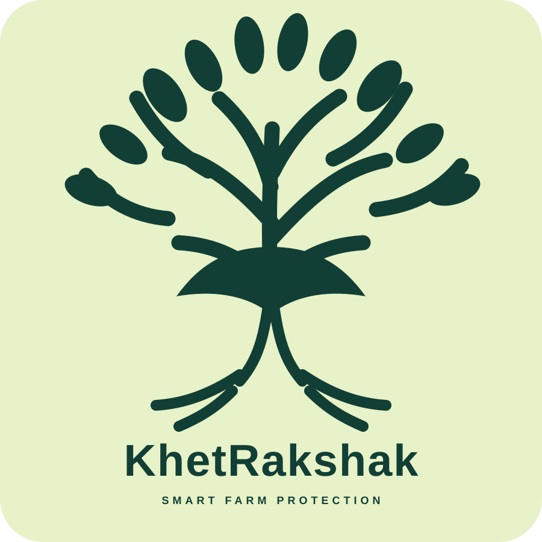
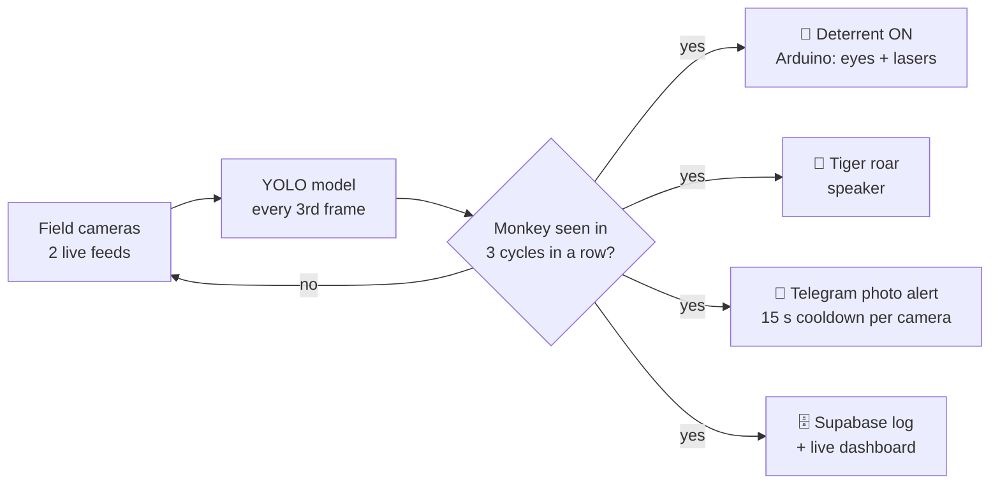

<h1 align="center">🐒 KhetRakshak — AI-Powered Monkey Detection & Crop Protection</h1>

<p align="center">
  
</p>

<p align="center">
  <b>A computer-vision early-warning system with non-harmful deterrents that reduces monkey crop raids for farmers in Nepal.</b><br/>
  YOLO · Flask · OpenCV · Arduino · Supabase · Telegram Bot API · Vite
</p>

<p align="center">
  <i>"Khet Rakshak" (खेत रक्षक) means "field guardian" in Nepali.</i>
</p>

---

## Table of Contents

1. [Overview](#1-overview)
2. [Key Features](#2-key-features)
3. [How It Works](#3-how-it-works)
4. [System Architecture](#4-system-architecture)
5. [Repository Structure](#5-repository-structure)
6. [The AI Model](#6-the-ai-model)
7. [Live Detection Logic](#7-live-detection-logic)
8. [Deterrent Hardware (Arduino)](#8-deterrent-hardware-arduino)
9. [🚀 Setting Up on a Brand-New Computer](#9--setting-up-on-a-brand-new-computer)
10. [📲 Telegram Alerts & Adding Chat IDs on the Live Monitoring Page](#10--telegram-alerts--adding-chat-ids-on-the-live-monitoring-page)
11. [Configuration Reference](#11-configuration-reference)
12. [Flask API Reference](#12-flask-api-reference)
13. [Web Dashboard Pages](#13-web-dashboard-pages)
14. [Other Components & Utility Scripts](#14-other-components--utility-scripts)
15. [Troubleshooting](#15-troubleshooting)
16. [Known Limitations](#16-known-limitations)
17. [Future Work](#17-future-work)
18. [Team](#18-team)
19. [References](#19-references)

---

## 1. Overview

### The problem

Rhesus macaques (*Rato Bandar*) are now one of the biggest worries for farmers in Nepal's mid-hills:

| Fact | Source |
|---|---|
| Crop damage was reported in **87.5%** of 120 surveyed localities. Monkeys entered houses in 60% and attacked people in 46.7% of them. | Koirala et al., 2022 |
| About **44%** of Nepal's land is suitable macaque habitat, but only **12%** of it lies inside protected areas. | Koirala et al., 2022 |
| Farmers in Kavre lose about **4.2%** of their annual farm income to monkeys. Maize makes up 58% of the crops taken. | Koirala et al., 2021 |
| In Pumdivumdi (Pokhara), **32%** of households lost more than NPR 20,000 in one year. | Sharma & Acharya, 2017 |
| Near Kathmandu (Jitpurphedi, Goldhunga), about **70%** of farmers have stopped farming part of their land. | Rai & Rai, 2024 |
| Nepal's forest cover fell by nearly **50%** between 1930 and 2014, and the forest broke into far more small patches. | Reddy et al., 2018 |

Today's methods (guard dogs, shouting, scarecrows, *machans*, carbide guns) all need **a person watching at the right moment**. Families take turns guarding fields all day, while young people leave villages for work.

### The solution

KhetRakshak replaces the human guard with a camera and a trained detector. When it is **confident** a monkey is present, it does three things at once:

1. 🔦 **Deters.** It flashes "scarecrow eyes" and lasers through an Arduino relay board and plays a tiger roar.
2. 📲 **Alerts.** It sends a Telegram message with a **photo**, the camera, the confidence and the time to the farmer's phone.
3. 🗄️ **Records.** It logs the event to Supabase and shows it on a live web dashboard.

All deterrents are **harmless**. They make the field unpleasant without hurting the animals.

---

## 2. Key Features

| Feature | Details |
|---|---|
| 🎥 **Dual-camera monitoring** | Two USB/webcam feeds handled at the same time in separate threads (~30 FPS capture each) |
| 🧠 **Custom-trained YOLO detector** | Two classes, `Monkey` and `Not monkey`. People are learned as an explicit negative class, so they don't set off the alarm. |
| ✅ **3-in-a-row confirmation** | A monkey must be detected in 3 consecutive detection cycles before any alarm fires. |
| ⏱️ **Alert cooldown** | At most one Telegram alert per camera every 15 seconds |
| 🔦 **Arduino deterrent** | 2 "eye" flashlights + 2 lasers on a 4-channel relay, 5 rotating light patterns, and a sweeping camera servo |
| 🐯 **Predator sound** | Tiger roar on loop through Pygame, with a Windows MCI / beep fallback |
| 📲 **Telegram photo alerts** | Recipients are set **per camera** from the Live Monitoring page. Includes a DNS-bypass fallback for ISPs that block `api.telegram.org`. |
| ☁️ **Cloud logging** | Detections stored in Supabase (PostgreSQL) |
| 📊 **Web dashboard** | Landing page, login, dashboard, live monitoring, history, notifications, analytics, speaker and light status, profile, settings |

---

## 3. How It Works



---

## 4. System Architecture

The system has three layers, all coordinated by one **Flask server**, [human-monkey/app.py](human-monkey/app.py):

| Layer | Components |
|---|---|
| **Vision layer** (project computer) | `CameraThread` ×2 grab frames. `DetectionThread` ×2 run YOLO. An MJPEG stream goes to the browser. |
| **Response layer** (field) | Arduino Uno + 4-channel relay → flashlights, lasers, servo. PC speaker → tiger roar. |
| **Cloud layer** | Supabase (`detections` table), Telegram Bot API → farmer's phone, web dashboard |

```
 ┌──────── On the field ────────┐   ┌──── Project computer (Flask :5000) ────┐   ┌──── Cloud & farmer ────┐
 │ Camera 1 (index 0) ──video──►│──►│ CameraThread 1 ─► DetectionThread 1 ─┐ │   │ Supabase (detections)  │
 │ Camera 2 (index 1) ──video──►│──►│ CameraThread 2 ─► DetectionThread 2 ─┤ │──►│ Telegram Bot API       │
 │ Speaker ◄─── tiger.mp3 ──────│◄──│            Alert logic ◄─────────────┘ │   │   └─► Farmer's phone   │
 │ Arduino ◄── serial "1"/"0" ──│◄──│  (3-in-a-row, 15 s cooldown)           │   │                        │
 │  └─ relays: eyes, lasers     │   │ /video_feed /status /set_phone ...  ◄──┼───┤ Web dashboard (Vite)   │
 │  └─ servo sweeps camera      │   └────────────────────────────────────────┘   └────────────────────────┘
 └──────────────────────────────┘
```

The browser never talks to Flask directly. The **Vite dev server** (port 3000) serves the dashboard from `Innovision/` and **proxies** `/flask/*` → `http://127.0.0.1:5000/*` (see [vite.config.js](vite.config.js)).

---

## 5. Repository Structure

```
monkey_detection/
├── human-monkey/               ★ MAIN LIVE SYSTEM (Flask + YOLO + Arduino + Telegram)
│   ├── app.py                  ★ Dual-camera detection server (port 5000)
│   ├── my_model/
│   │   ├── best.pt             Model loaded by app.py (see §6.5)
│   │   ├── latest_best.pt      YOLO26n-cls image classifier (newest experiment)
│   │   ├── others/best.pt      YOLO26n detector (the model described in the report)
│   │   ├── data.yaml           Class names (monkey, not_monkey)
│   │   └── yolo_detect.py      Stand-alone detection script (image/video/webcam)
│   ├── sounds/tiger.mp3        Deterrent sound (dog.mp3 also included)
│   ├── Training.ipynb          Training notebook (Kaggle)
│   ├── camera_test.py          Quick webcam check
│   ├── demo.py                 Sends one test Telegram alert
│   └── templates/              Minimal Flask HTML pages
│
├── Innovision/                 ★ WEB DASHBOARD (static HTML/CSS/JS, served by Vite)
│   ├── landingpage.html, login.html, registration.html
│   ├── dashboard.html, live-monitoring.html, detection-history.html
│   ├── notifications.html, analytics.html, speaker-status.html
│   ├── warning-light-status.html, profile.html, settings.html, contact.html
│   ├── css/  js/  assets/
│
├── arduino_code/
│   └── arduino_code.ino        ★ Relay + servo deterrent firmware
│
├── backend/                    Alternative FastAPI service layer (clean architecture, port 8000)
│   ├── main.py, app/{config,controllers,models,routes,services,utils}
│   └── requirements.txt
│
├── src/                        React + Supabase auth module (Supabase email/Google login)
├── vite.config.js              Vite config: root = Innovision/, proxy /flask → :5000
├── package.json                npm scripts (starts Flask + Vite together)
├── server.js                   Plain static file server (no Flask proxy, see §15)
└── .env.example                Environment variable template
```

> ℹ️ [human-monkey/README.md](human-monkey/README.md), `Dockerfile`, `Procfile` and `requirements.txt` in `human-monkey/` come from the original open-source YOLOv7 monkey-detection project this folder started from. They **do not** describe the current system. Use this README instead.

---

## 6. The AI Model

### 6.1 Dataset — 3,760 images

| Part | Count | Source |
|---|---|---|
| Monkey images | ~3,560 | Internet images with varied poses, cameras, backgrounds and lighting, plus our own phone photos from **Swayambhunath** and **Pashupatinath** (Kathmandu), where rhesus macaques live alongside people |
| Human images ("Not monkey") | ~200 | Added on purpose as **hard negatives** (see §6.3) |

The dataset was grown in rounds: train, look at the failures, collect more images of those failure cases, then train again.

### 6.2 Labelling with SAM 3

Drawing boxes by hand on 3,760 images would have taken weeks. Instead:

```
Collect 3,760 photos → SAM 3 (text prompt "monkey") → mask → tight bounding box
                     → human review in Label Studio → export YOLO-format labels
```

SAM 3 (Meta, 2025) accepts a **text prompt**. Every box was then checked in Label Studio: loose boxes were fixed, missed animals added, and people tagged as `Not monkey`.

### 6.3 Teaching the model what is *not* a monkey

Early models labelled **people as monkeys**, because humans and monkeys have a similar body plan. On a farm that would be fatal to the product, since a system that fires every time a farmer walks by gets switched off. Adding ~200 human images as a second class (**hard negative mining**) taught the model the difference. In the live system **only the `Monkey` class triggers alarms**. `Not monkey` boxes are drawn on screen but are ignored by the alert logic.

### 6.4 Training (Kaggle, free GPU)

| Setting | Value |
|---|---|
| Framework | Ultralytics 8.4.118 |
| Starting weights | YOLO26n, pre-trained on COCO (transfer learning) |
| Epochs / image size / batch | 100 / 640×640 / 16 |
| Learning rate | 0.01 → decays to 1% of that |
| Optimizer | `auto` (chosen by Ultralytics) |
| Early-stopping patience | 30 epochs |
| Mixed precision (AMP) | On |
| Training time | ~16 minutes |
| Augmentation | Mosaic (turned off for the last 10 epochs), HSV colour jitter, horizontal flip, scale ±50%, translate, random erasing, RandAugment |
| Loss terms | Box loss, classification loss, L1 box loss (YOLO26 end-to-end head) |

**Why YOLO26n:** it is NMS-free (one box per object, no post-processing step) and has no DFL module. Its small-object training (ProgLoss, STAL) helps with distant monkeys. Ultralytics reports up to 43% faster CPU inference than YOLO11n, and the weights are only ~5 MB, so it runs on an ordinary laptop with no GPU.

### 6.5 Results & the model files in this repo

The repo contains **several trained weight files**. Their metadata (read from inside each checkpoint):

| File | Architecture | Classes | Validation metrics | Notes |
|---|---|---|---|---|
| `human-monkey/my_model/best.pt` | **YOLO11s** detector, 60 epochs, 19 MB | `Monkey`, `Not monkey` | P 90.5% · R 92.8% · **mAP@0.5 96.7%** · mAP@0.5:0.95 58.1% | Round-1 model on the earlier dataset. **This is what `app.py` loads by default.** |
| `human-monkey/my_model/others/best.pt` | **YOLO26n** detector, 100 epochs, ~5 MB | `monkey` | **P 87.8% · R 64.3% · mAP@0.5 73.0% · mAP@0.5:0.95 59.2%** | Final-round model on the full 3,760-image dataset. Best checkpoint at epoch 98. Matches the project report. |
| `human-monkey/my_model/latest_best.pt` | **YOLO26n-cls** image *classifier*, 224 px, ~3 MB | `monkey`, `not_monkey` | Top-1 accuracy 99.9% | Newest experiment. Classifies the whole frame and draws no boxes. `app.py` supports it (draws a frame-wide box). |

> The round-1 and final-round scores were measured on **different validation sets**, so you can't compare them directly. The final round improved the stricter mAP@0.5:0.95 (58.1% → 59.2%) with a model about 3.6× smaller.

**Why precision matters most:** every false alarm wastes the farmer's attention and fires the deterrent for nothing. Recall per *still image* is lower, but in live video the model checks about 10 frames per second, so a monkey in view for a few seconds gets many chances to be caught. Measuring this in field trials is the next step.

**Switching models:** `app.py` checks these paths in order and uses the first one that exists:
`my_model/best.pt` → `$MODEL_PATH` → `my_model/new_best.pt` → `my_model/my_model.pt`.
To run a different model, copy it over `my_model/best.pt` (back up the original first). Setting `MODEL_PATH` alone has no effect while `my_model/best.pt` exists.

---

## 7. Live Detection Logic

All in [human-monkey/app.py](human-monkey/app.py):

| # | Step | Implementation |
|---|---|---|
| 1 | **Two cameras, two threads** | `CameraThread(cam_id=1, src_index=0)` and `CameraThread(cam_id=2, src_index=1)`, opened at 640×480 with DirectShow on Windows |
| 2 | **Smart sampling** | `DETECT_EVERY = 3`: inference runs on every 3rd frame. A global `_inference_lock` stops both cameras running YOLO at the same instant. |
| 3 | **Confidence filter** | `CONFIDENCE_THRESHOLD` env var, default `0.40` |
| 4 | **Monkey-only trigger** | A class counts only if its name contains "monkey" **and** does not contain `not`, `non`, `no_`, `human`, `person` or `background` |
| 5 | **3-in-a-row debounce** | `DEBOUNCE_FRAMES = 3` consecutive positive detection cycles are needed |
| 6 | **Alert cooldown** | `SMS_COOLDOWN_SECONDS = 15` per camera for Telegram |
| 7 | **Response** | Serial `b"1"` to Arduino, tiger roar on loop, Telegram photo alert (background thread), Supabase insert (background thread) |
| 8 | **Clear** | When no camera has a confirmed monkey: serial `b"0"` and the sound stops |

The MJPEG stream (`/video_feed/<cam_id>`) overlays boxes and a status banner: `STATUS: CLEAR`, `VERIFYING MONKEY... [n/3]` (yellow) or `ALERT: MONKEY DETECTED` (red header, green box).

---

## 8. Deterrent Hardware (Arduino)

### 8.1 Bill of materials

| Item | Qty | Purpose |
|---|---|---|
| Arduino Uno (or compatible) + USB cable | 1 | Receives commands over serial |
| 4-channel relay module (**active-LOW**) | 1 | Switches lights and lasers |
| Flashlights ("scarecrow eyes") | 2 | Flashing predator eyes |
| Laser modules | 2 | Moving light deterrent |
| SG90/MG90 servo | 1 | Sweeps the camera from 30° to 150° while in standby |
| Speaker | 1 | Plays the tiger roar from the PC |
| USB webcams | 1–2 | Field cameras |

### 8.2 Wiring

| Arduino pin | Connected to |
|---|---|
| D6 (PWM) | Servo signal |
| D7 | Relay 3 → Laser 1 |
| D8 | Relay 4 → Laser 2 |
| D9 | Relay 1 → Left eye flashlight |
| D10 | Relay 2 → Right eye flashlight |
| 5V / GND | Relay VCC/GND, servo power (use an external 5 V supply for the servo if it jitters) |

### 8.3 Serial protocol (9600 baud)

| Command | Effect |
|---|---|
| `1` | Monkey detected: lasers ON and run the next eye pattern for **10 s**, then reset to standby |
| `0` | Emergency stop / clear: all relays OFF, works even in the middle of a pattern |

The five patterns rotate after each detection so monkeys can't get used to one: **1** alternating strobe → **2** predator stare + burst → **3** wink and burst → **4** random flicker → **5** heartbeat pulse → back to 1.

---

## 9. 🚀 Setting Up on a Brand-New Computer

These steps are written for **Windows 10/11**, which the project was built and tested on. macOS/Linux differences are noted where they matter.

### 9.1 Install prerequisites

| Software | Version | Get it from | Check |
|---|---|---|---|
| **Git** | any | https://git-scm.com/downloads | `git --version` |
| **Python** | **3.11 – 3.13** (tested on 3.13.1) | https://www.python.org/downloads/ — **tick "Add python.exe to PATH"** | `python --version` |
| **Node.js** | **18+ LTS** (tested on 22.17) | https://nodejs.org | `node --version` · `npm --version` |
| **Arduino IDE** | 2.x | https://www.arduino.cc/en/software | Only needed for the hardware |

A GPU is **not** required. Detection runs on the CPU.

### 9.2 Get the code

```powershell
git clone <your-repository-url> monkey_detection
cd monkey_detection
```

> The `.pt` weight files are committed to the repo, so no separate model download is needed. Check that `human-monkey\my_model\best.pt` exists after cloning.

### 9.3 Create the Python virtual environment

> ⚠️ The venv **must** be called `.venv` and sit in the **repository root**. The npm scripts call `..\.venv\Scripts\python` directly.

```powershell
python -m venv .venv
.\.venv\Scripts\python -m pip install --upgrade pip
.\.venv\Scripts\python -m pip install ultralytics "flask==2.2.2" "werkzeug<3.0" flask-cors opencv-python pygame pyserial python-dotenv pyyaml requests
```

`ultralytics` pulls in PyTorch (CPU build) automatically. The install is about 1 GB and takes a few minutes.

> Don't use `human-monkey/requirements.txt`. It belongs to the old YOLOv7 project and is missing `ultralytics`, `pyserial`, `pygame` and `flask-cors`.

*(Optional)* For NVIDIA GPU acceleration, install a CUDA build of PyTorch afterwards from https://pytorch.org/get-started/locally/.

**macOS / Linux:** use `python3 -m venv .venv` and `./.venv/bin/python -m pip install ...`.

### 9.4 Install the web dependencies

```powershell
npm install
```

This installs Vite, React, `@supabase/supabase-js` and `concurrently`.

### 9.5 Create your `.env` file

```powershell
copy .env.example .env
```

Then open `.env` and fill in **your own** values:

```dotenv
# --- Supabase (optional: detections are only logged when these are set) ---
SUPABASE_URL=https://<your-project-ref>.supabase.co
SUPABASE_KEY=<your-supabase-anon-key>
SUPABASE_SERVICE_KEY=<your-supabase-service-role-or-anon-key>
VITE_SUPABASE_URL=https://<your-project-ref>.supabase.co
VITE_SUPABASE_ANON_KEY=<your-supabase-anon-key>

# --- Telegram (needed for phone alerts, see §10) ---
TELEGRAM_BOT_TOKEN=<token-from-BotFather>
TELEGRAM_CHAT_ID=<default-chat-id>      # optional: added to BOTH cameras at startup

# --- Detection ---
CONFIDENCE_THRESHOLD=0.40
```

`app.py` finds this root `.env` automatically. Never commit `.env`; it is already in `.gitignore`.

### 9.6 (Optional) Set up Supabase

Skip this to run fully offline. Detection, the deterrent and Telegram all still work.

1. Create a free project at https://supabase.com.
2. Go to **Project Settings → API** and copy the **Project URL** and the **anon** key (plus the **service_role** key if you want it) into `.env`.
3. In the **SQL Editor**, create the table the live system writes to:

   ```sql
   create table if not exists public.detections (
     id           bigint generated always as identity primary key,
     created_at   timestamptz not null default now(),
     device_id    text,          -- "Camera 01" / "Camera 02"
     object_class text,          -- "monkey"
     confidence   numeric,       -- percent, e.g. 92.4
     image_url    text,
     metadata     jsonb default '{}'::jsonb   -- cam_id, timestamp, location
   );

   alter table public.detections enable row level security;

   -- Demo-friendly policies (tighten these for production)
   create policy "detections insert" on public.detections for insert to anon with check (true);
   create policy "detections read"   on public.detections for select to anon using (true);
   ```

4. The dashboard pages read Supabase through [Innovision/js/api-client.js](Innovision/js/api-client.js), where the URL and anon key are **hard-coded** (`SUPABASE_URL`, `SUPABASE_ANON_KEY`). Replace them with your project's values.

> The optional FastAPI service in `backend/` also uses the tables `farmers`, `devices`, `notifications`, `speakers`, `speaker_logs`, `system_logs` and `analytics_daily`. The live Flask system only needs `detections`.

### 9.7 (Optional) Flash the Arduino

1. Wire the hardware as shown in [§8.2](#82-wiring).
2. Open [arduino_code/arduino_code.ino](arduino_code/arduino_code.ino) in the Arduino IDE.
3. Select **Tools → Board → Arduino Uno** and the right **Port**, then click **Upload**.
4. Find the COM port in **Device Manager → Ports (COM & LPT)**, for example `COM5`.
5. **Edit the port in `app.py`**. It is hard-coded and does *not* read `SERIAL_PORT` from `.env`:

   ```python
   # human-monkey/app.py
   ARDUINO_PORT = "COM9"      # ← change to your port, e.g. "COM5"  (Linux: "/dev/ttyUSB0" or "/dev/ttyACM0", macOS: "/dev/cu.usbmodemXXXX")
   ARDUINO_BAUD = 9600
   ```

6. **Close the Arduino IDE Serial Monitor** before starting the server. Only one program can hold the port.

Without an Arduino, the server logs `Arduino connection failed on COM9` and **carries on normally**, with no deterrent lights.

### 9.8 Connect the cameras

| Dashboard camera | OpenCV index | Typically |
|---|---|---|
| Camera 01 | `0` | Built-in laptop webcam or the first USB camera |
| Camera 02 | `1` | Second USB camera |

Quick test: `cd human-monkey` then `..\.venv\Scripts\python camera_test.py` (press **Esc** to close).
With only one camera, Camera 02 shows as offline. That's fine.
To change indices, edit `camera_threads = {1: CameraThread(cam_id=1, src_index=0), 2: CameraThread(cam_id=2, src_index=1)}` in `app.py`.

On Windows, also check **Settings → Privacy & security → Camera** and allow desktop apps to use the camera.

### 9.9 Run everything

From the **repository root**:

```powershell
npm run dev
```

This starts two processes side by side (via `concurrently`):

| Prefix | Process | URL |
|---|---|---|
| `FLASK` (yellow) | `human-monkey/app.py`: loads the model, opens cameras and Arduino | http://127.0.0.1:5000 |
| `VITE` (cyan) | Dashboard dev server with the `/flask` proxy | http://localhost:3000 |

The browser opens `landingpage.html` automatically. Wait for `Starting Flask application server on http://127.0.0.1:5000` in the console; the first model load can take 10–30 s.

Then:

1. Click **Sign In**. The dashboard login is a front-end demo: any valid email and a password of 6+ characters will work.
2. Open **Live Monitoring**: **http://localhost:3000/live-monitoring.html**
3. The camera feeds appear with live boxes. Add your Telegram Chat ID ([§10](#10--telegram-alerts--adding-chat-ids-on-the-live-monitoring-page)).
4. Show the camera a monkey picture on a phone screen to test the full pipeline.

**Running the two parts separately** (in two terminals):

```powershell
# Terminal 1 – detection server
cd human-monkey
..\.venv\Scripts\python app.py

# Terminal 2 – dashboard
npx vite --host 0.0.0.0
```

**macOS / Linux:** the npm scripts use Windows paths, so start the parts separately: `cd human-monkey && ../.venv/bin/python app.py` and `npx vite --host 0.0.0.0`.

Stop everything with **Ctrl + C**. On shutdown the server releases the cameras, stops the sound and sends `0` to the Arduino.

---

## 10. 📲 Telegram Alerts & Adding Chat IDs on the Live Monitoring Page

Alerts go out through a **Telegram bot**. Every confirmed detection sends this message to every Chat ID registered for that camera:

```
🚨 khetRakshak MONKEY ALERT! 🐒
📷 Camera: Camera 01
🎯 Confidence: 91.3%
⏰ Time: 10:20 AM
📍 Location: Protected Farm Area
```

The message comes **with a snapshot photo** of the frame.

### Step 1 — Create the bot (once per installation)

1. In Telegram, open a chat with **@BotFather** (the official one, with the blue tick).
2. Send `/newbot`, then choose a display name (e.g. `KhetRakshak Alerts`) and a username ending in `bot` (e.g. `khetrakshak_farm_bot`).
3. BotFather replies with a **token** like `1234567890:AAH...`. Put it in `.env`:
   ```dotenv
   TELEGRAM_BOT_TOKEN=1234567890:AAH...
   ```
4. Restart the server. Without a token, alerts are only *simulated* and the log shows `[Telegram] No BOT_TOKEN - simulated alert ...`.

> 🔒 Treat the token like a password. Anyone who has it can send messages as your bot.

### Step 2 — Every recipient must start the bot

Telegram bots **can't message a user who hasn't messaged them first**. Each farmer or family member who wants alerts must:

1. Search for the bot's username in Telegram (or open `https://t.me/<your_bot_username>`).
2. Press **START** (or send any message, e.g. `hi`).

Skip this and the server log shows `[Telegram] API error 403: Forbidden: bot can't initiate conversation with a user`, or `400: chat not found`.

### Step 3 — Find the Chat ID

A Chat ID is a **number**, not a phone number or username.

**Option A — @userinfobot (easiest):** open **@userinfobot** in Telegram, press Start, and it replies with your `Id: 123456789`.

**Option B — from your own bot:** after sending your bot a message (Step 2), open this URL in a browser:

```
https://api.telegram.org/bot<YOUR_BOT_TOKEN>/getUpdates
```

Look for `"chat":{"id":123456789, ...}`. That number is the Chat ID.

**Sending alerts to a group:** add the bot to a Telegram group, send a message in the group, then use Option B. Group IDs are **negative**, e.g. `-1001234567890`. Include the minus sign.

### Step 4 — Add the Chat ID on the Live Monitoring page

1. Make sure `npm run dev` is running and Flask has finished starting.
2. Open **http://localhost:3000/live-monitoring.html**.
3. Each camera card (**Camera 01**, **Camera 02**) has a section at the bottom called **✈️ Telegram Alert Chat IDs**:

   ```
   ✈️ Telegram Alert Chat IDs                         1
   [ ☎️ 123456789  × ]
   ┌───────────────────────────────┐ ┌────────┐
   │ e.g. 123456789                │ │ + Add  │
   └───────────────────────────────┘ └────────┘
   ```

4. Type the Chat ID into the box and click **+ Add** (or press **Enter**).
5. A chip with the ID appears and the input briefly shows **✓ Added!**. The list refreshes from the server every few seconds.
6. Add **as many IDs as you like per camera**, for example the farmer on Camera 01 and the whole family group on both cameras.
7. Click **×** on a chip to remove that ID.

Behind the scenes the page calls `POST /flask/set_phone/<cam_id>` with `{"phone": "<chat id>"}`, and `POST /flask/remove_phone/<cam_id>/<index>` to remove one. The current list comes back in `GET /flask/status` → `cam1.phones` / `cam2.phones`.

### Step 5 — ⚠️ Make it permanent

Chat IDs added on the page are kept **in the Flask server's memory only**. **They are lost when `app.py` restarts.**

To keep a recipient permanently, put their ID in `.env`:

```dotenv
TELEGRAM_CHAT_ID=123456789
```

At startup this ID is added to **both** cameras. It is also the fallback whenever a camera's list is empty. Only one ID is supported here; add extra recipients through the page after each restart.

### Step 6 — Test it

**Send a test message directly** (checks the token and Chat ID, no server needed). In PowerShell:

```powershell
Invoke-RestMethod "https://api.telegram.org/bot<YOUR_BOT_TOKEN>/sendMessage?chat_id=<CHAT_ID>&text=KhetRakshak%20test"
```

**Add a Chat ID without the browser** (server must be running):

```powershell
Invoke-RestMethod -Method Post -Uri http://127.0.0.1:5000/set_phone/1 -ContentType 'application/json' -Body '{"phone":"123456789"}'
```

**End-to-end:** hold a monkey photo up to Camera 01. After 3 confirmations (about 1 second) the console shows `MONKEY ALERT CONFIRMED` then `[Telegram] Sent alert to 123456789 (Camera 1)`, and the photo arrives on the phone. Further alerts from the same camera are held back for **15 seconds**.

**Using `demo.py`:** [human-monkey/demo.py](human-monkey/demo.py) sends one alert to a hard-coded Chat ID. Change the ID to your own before running `..\.venv\Scripts\python demo.py` from `human-monkey/`. It imports `app.py`, so the model loads first.

### Telegram troubleshooting

| Symptom in console | Cause → Fix |
|---|---|
| `simulated alert` | `TELEGRAM_BOT_TOKEN` missing → set it in the root `.env` and restart |
| `API error 401: Unauthorized` | Wrong or revoked token → copy it again from @BotFather |
| `API error 400: chat not found` | Wrong Chat ID, or the user/group never messaged the bot → redo Steps 2–3 |
| `API error 403: bot was blocked by the user` | The recipient blocked or stopped the bot → they must unblock it and press Start |
| `Connection error` | No internet, or the ISP blocks Telegram. `app.py` already retries through Telegram's direct data-centre IPs. If it still fails, try another network or a VPN. |
| Chip shows but no alert arrives | Check the 15 s cooldown, check the alert is *confirmed* (red banner, not yellow "VERIFYING"), and check the chip is on the camera that saw the monkey |
| IDs vanished | The server restarted → see Step 5 |
| `+ Add` does nothing | The page isn't going through Vite, or Flask is down → open it at `localhost:3000` from `npm run dev` and check that `http://127.0.0.1:5000/status` loads |

---

## 11. Configuration Reference

### Environment variables (root `.env`)

| Variable | Used by | Default | Purpose |
|---|---|---|---|
| `TELEGRAM_BOT_TOKEN` | Flask, backend | — | Bot token from @BotFather |
| `TELEGRAM_CHAT_ID` | Flask, backend | — | Default recipient for both cameras |
| `SUPABASE_URL` | Flask, backend | — | Supabase project URL (no trailing slash) |
| `SUPABASE_SERVICE_KEY` / `SUPABASE_KEY` | Flask, backend | — | Key used for inserts (service key is tried first) |
| `VITE_SUPABASE_URL`, `VITE_SUPABASE_ANON_KEY` | React auth module (`src/`) | — | Supabase client in the browser |
| `CONFIDENCE_THRESHOLD` | Flask | `0.40` | Minimum detection confidence |
| `MODEL_PATH` | Flask (backup only), backend | — | See [§6.5](#65-results--the-model-files-in-this-repo) |
| `SERIAL_PORT`, `BAUD_RATE`, `CAMERA_INDEX` | **backend only** | — | Flask uses the hard-coded values below |

### Constants hard-coded in `human-monkey/app.py`

| Constant | Value | Meaning |
|---|---|---|
| `ARDUINO_PORT` / `ARDUINO_BAUD` | `"COM9"` / `9600` | Arduino serial port |
| `DETECT_EVERY` | `3` | Run inference on every Nth frame |
| `DEBOUNCE_FRAMES` | `3` | Consecutive positives needed before an alert |
| `SMS_COOLDOWN_SECONDS` | `15` | Minimum gap between Telegram alerts per camera |
| `SOUND_FILE` | `sounds/tiger.mp3` | Deterrent audio (swap in `dog.mp3` if you like) |
| Camera sources | index `0` and `1` | `camera_threads` dictionary |
| Flask host/port | `0.0.0.0:5000` | Last line of the file |

---

## 12. Flask API Reference

Base URL: `http://127.0.0.1:5000`. From the dashboard, call it through the proxy as `/flask/...`.

| Method | Endpoint | Description |
|---|---|---|
| `GET` | `/` | Minimal built-in page (`templates/index.html`) |
| `GET` | `/video_feed/<cam_id>` | MJPEG stream with detection overlay (`cam_id` = 1 or 2) |
| `POST` | `/start/<cam_id>` | Open the camera and start detecting |
| `POST` | `/stop/<cam_id>` | Stop the camera. When both are stopped, the sound stops and the Arduino gets `0`. |
| `GET` | `/status` | JSON health/status for both cameras (below) |
| `POST` | `/set_phone/<cam_id>` | Body `{"phone": "<telegram chat id>"}`: add an alert recipient |
| `POST` | `/remove_phone/<cam_id>/<idx>` | Remove recipient number `idx` (0-based) |

Example `/status` response:

```json
{
  "cam1": { "running": true,  "camera_online": true,  "monkey_alert": true,
            "confidence": 91.3, "phones": ["123456789"], "last_detection": "Today, 10:20 AM" },
  "cam2": { "running": false, "camera_online": false, "monkey_alert": false,
            "confidence": 0.0,  "phones": [], "last_detection": null }
}
```

(The endpoint is called `set_phone` for historical reasons. It was first built for SMS. The value is now a **Telegram Chat ID**.)

---

## 13. Web Dashboard Pages

All pages are in [Innovision/](Innovision/) and are served by Vite at `http://localhost:3000/<page>.html`.

| Page | What it shows |
|---|---|
| `landingpage.html` | Product intro, features, how it works, contact |
| `login.html` / `registration.html` | Sign-in (email / Google button) and sign-up |
| `dashboard.html` | Active cameras, speakers, today's detections, alerts sent, system health, live previews, recent alerts, detection history preview |
| **`live-monitoring.html`** | **Both live feeds with boxes, farm status, camera on/off, full-screen view, live activity log, and Telegram Chat ID management** |
| `detection-history.html` | Table of past detections (from Supabase) with filters |
| `notifications.html` | Alert history |
| `analytics.html` | Detection trends and charts |
| `speaker-status.html` / `warning-light-status.html` | Deterrent device status |
| `profile.html` / `settings.html` | Farmer profile and preferences |
| `contact.html` | Support contact |

The dashboard has a dark/light theme toggle ([Innovision/js/theme.js](Innovision/js/theme.js)) and works on desktop and mobile.

---

## 14. Other Components & Utility Scripts

### Stand-alone detection (no server, no dashboard)

```powershell
cd human-monkey
..\.venv\Scripts\python my_model\yolo_detect.py --model my_model\best.pt --source usb0 --thresh 0.4 --resolution 640x480
```

`--source` accepts an image file, a folder, a video file, or `usb0`/`usb1` for a webcam. Add `--record` to save `demo1.avi` (this needs `--resolution`).

### FastAPI backend ([backend/](backend/))

A separate, cleanly layered service (config → routes → controllers → services) with Supabase, Arduino, Telegram and detector services, plus REST endpoints like `/api/health`, `/api/detections` and `/api/dashboard/summary` used by [Innovision/js/api-client.js](Innovision/js/api-client.js). It is **not needed** for the live system above. To try it:

```powershell
cd backend
copy .env.example .env      # fill in values
..\.venv\Scripts\python -m pip install -r requirements.txt ultralytics opencv-python
..\.venv\Scripts\python main.py          # http://localhost:8000  (docs at /docs)
```

> Only one program can open the Arduino COM port and each webcam at a time. Don't run `backend/main.py` and `human-monkey/app.py` against the same hardware simultaneously.

### Training your own model

[human-monkey/Training.ipynb](human-monkey/Training.ipynb) contains the Kaggle training workflow. In short:

```python
from ultralytics import YOLO
model = YOLO("yolo26n.pt")                     # COCO pre-trained
model.train(data="data.yaml", epochs=100, imgsz=640, batch=16, patience=30)
```

`data.yaml` must list the classes as `monkey` and `not_monkey`. Copy the resulting `runs/detect/train/weights/best.pt` to `human-monkey/my_model/best.pt`.

### Production build of the dashboard

```powershell
npm run build      # → dist/
npm run preview    # serves dist/ on :4173
```

The `/flask` proxy only exists in the Vite dev server. In production, put the site and Flask behind one reverse proxy (e.g. nginx) that forwards `/flask/` → `127.0.0.1:5000`.

---

## 15. Troubleshooting

| Problem | Fix |
|---|---|
| `'..\.venv\Scripts\python' is not recognized` | The venv is missing or in the wrong place → create `.venv` in the **repo root** ([§9.3](#93-create-the-python-virtual-environment)) |
| `ModuleNotFoundError: ultralytics` / `serial` / `pygame` / `flask_cors` | Run the pip install from §9.3 again **with the venv's Python** |
| `ImportError: cannot import name 'url_quote' from 'werkzeug'` | `pip install "werkzeug<3.0"` |
| `ERROR: No valid model file found` | `human-monkey/my_model/best.pt` is missing. Also check you started `app.py` from **inside** `human-monkey/`, because paths are relative. |
| `OMP: Error #15 ... libiomp5md.dll` | Already handled by `KMP_DUPLICATE_LIB_OK=TRUE` in `app.py`. If you see it elsewhere, set that env var. |
| "Flask backend not reachable" on Live Monitoring | Flask is still loading or crashed → read the `FLASK` console output. Make sure you opened the page through **Vite** (`npm run dev`), **not** `node server.js`, which has no `/flask` proxy. |
| Black / no video | Another app (Zoom, Teams, Camera) is using the webcam, camera permission is off, or the index is wrong → close other apps and run `camera_test.py` |
| `Arduino connection failed on COM9` | Wrong port → edit `ARDUINO_PORT` ([§9.7](#97-optional-flash-the-arduino)). Close the Arduino Serial Monitor and check the USB cable carries data. |
| Relays switch the wrong way round | The code assumes an **active-LOW** relay module. For active-HIGH boards, swap `RELAY_ON`/`RELAY_OFF` in the sketch. |
| No sound | Check `human-monkey/sounds/tiger.mp3` exists and the system volume is up. The log shows which audio engine loaded (`Pygame`, `MCI` or `Beep`). |
| Port 3000 busy | Vite picks the next free port automatically; read the URL in the `VITE` console output |
| People detected as monkeys | Raise `CONFIDENCE_THRESHOLD` (e.g. `0.55`), or switch to another model file ([§6.5](#65-results--the-model-files-in-this-repo)) |
| Slow / laggy feed on an old laptop | Increase `DETECT_EVERY` to 5, use a smaller model (`others/best.pt`, YOLO26n), or run only one camera |

---

## 16. Known Limitations

Be aware of these before a demo or deployment:

- 🔐 **Secrets in the example files.** `.env.example` and `backend/.env.example` currently contain what look like real Supabase and Telegram credentials, and [Innovision/js/api-client.js](Innovision/js/api-client.js) hard-codes the Supabase anon key. Replace them with placeholders and **revoke the bot token with @BotFather** (`/revoke`) if the repo is or was public.
- **Chat IDs aren't persisted.** IDs added on the Live Monitoring page live in memory only ([§10 Step 5](#step-5--️-make-it-permanent)).
- **The dashboard login is a demo.** `login.html` accepts any valid email with a 6+ character password and stores the name in `localStorage`. Real Supabase email/Google auth exists in the React module ([src/](src/)), but it isn't wired into the HTML dashboard.
- **Many dashboard figures are sample data**, such as speaker status and parts of analytics. Live data comes from `/flask/status` and the Supabase `detections` table.
- **Hard-coded hardware settings.** The Arduino port (`COM9`) and camera indices are set in `app.py`, not `.env`.
- **Model precedence.** `MODEL_PATH` is ignored while `my_model/best.pt` exists. The default loaded model is the round-1 YOLO11s, not the final YOLO26n.
- **Snapshots aren't uploaded to Supabase Storage** by the Flask server yet. Only the detection row is inserted, and the photo goes to Telegram.
- **No night vision yet.** The model was trained on daylight RGB images.
- **Field trials are still pending.** The model has been tested on validation images and indoor demos.

---

## 17. Future Work

- 🌾 **Field trial** on a farm in a monkey-affected area (e.g. Jitpurphedi or Goldhunga) for several weeks, measuring detection rate and how monkeys respond.
- 📱 **SMS alerts** through a local gateway for farmers with basic phones.
- 💦 **Smarter deterrents.** Sprinklers, directional ultrasound and more predator sounds, all still harmless, plus learning which pattern clears monkeys fastest.
- 🌙 **Night mode.** Infrared cameras and night-time training images for 24/7 protection.
- ☀️ **Edge + solar.** Raspberry Pi or Jetson Nano on solar power, for areas without mains electricity or internet.
- 🔐 Saving per-camera Chat IDs to Supabase, real auth on every dashboard page, and settings from `.env`.

---

## 18. Team

Built at **Sunway College Kathmandu** (in academic partnership with **Birmingham City University**).

| Team members | Supervisor |
|---|---|
| Grishma Karki · Prachi Magar · Prince KC · Samriddhi Dumre | Mr. Prabigya Acharya |

---

## 19. References

1. Koirala, S., Baral, S., Garber, P. A., et al. (2022). *Identifying the environmental and anthropogenic causes, distribution, and intensity of human–rhesus macaque conflict in Nepal.* Journal of Environmental Management, 316, 115276.
2. Koirala, S., Garber, P. A., Somasundaram, D., et al. (2021). *Factors affecting the crop raiding behavior of wild rhesus macaques in Nepal: Implications for wildlife management.* Journal of Environmental Management, 297, 113331.
3. Reddy, C. S., Vazeed Pasha, S., Satish, K. V., et al. (2018). *Quantifying nationwide land cover and historical changes in forests of Nepal (1930–2014).* Biodiversity and Conservation, 27, 91–107.
4. Sharma, S., & Acharya, S. (2017). *Human–rhesus macaque conflict at Pumdivumdi/Tallokodi, Pokhara, West Nepal.* Banko Janakari, 27(2).
5. Rai, S., & Rai, R. (2024). *Monkey menace in Nepal: An analysis and proposed solutions.* Journal of Multidisciplinary Sciences, 6(1), 26–31.
6. Joshi, A. R. (2024). *In Nepal, debate rages on crop-raiding monkeys.* Dialogue Earth.
7. Ultralytics (2026). *YOLO26 documentation.* https://docs.ultralytics.com
8. Meta AI (2025). *SAM 3: Segment Anything with Concepts.* https://ai.meta.com/sam3
9. Redmon, J., Divvala, S., Girshick, R., & Farhadi, A. (2016). *You Only Look Once: Unified, real-time object detection.* CVPR, 779–788.

---

<p align="center"><i>KhetRakshak: a field guardian that never takes a break. 🌾🐒</i></p>
